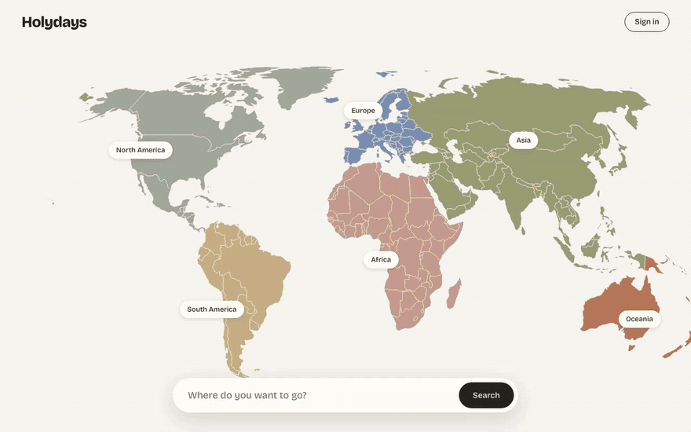
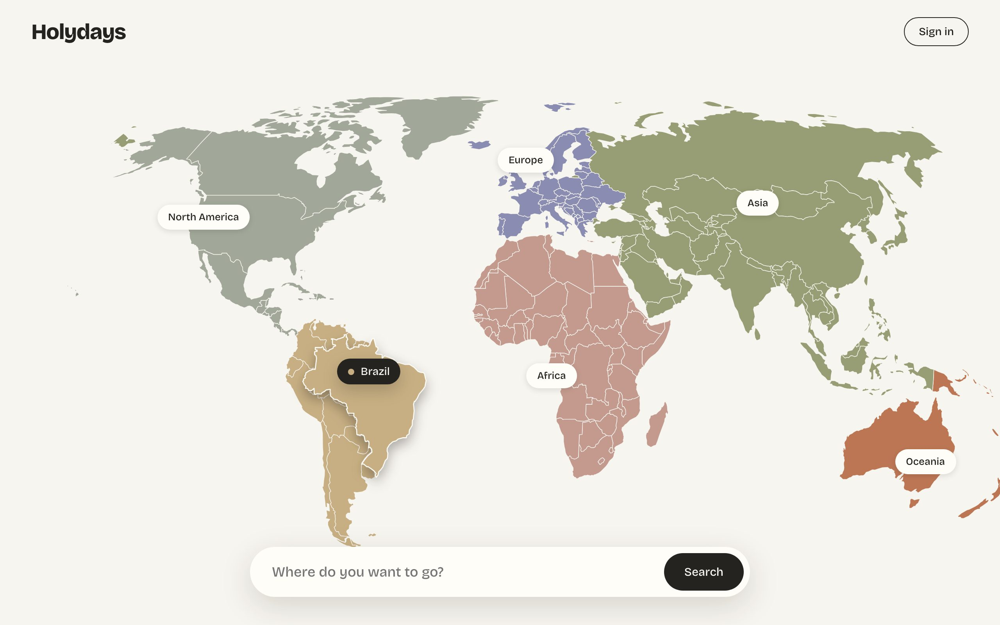
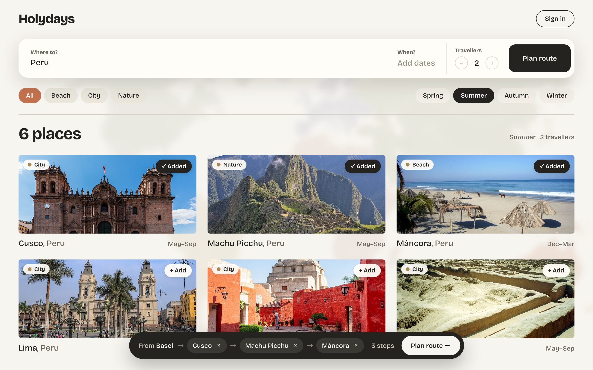
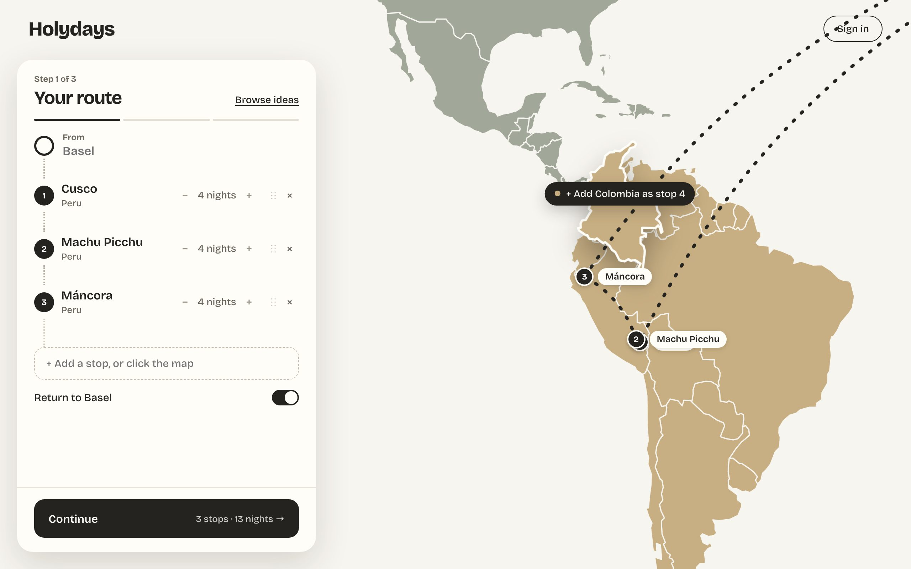
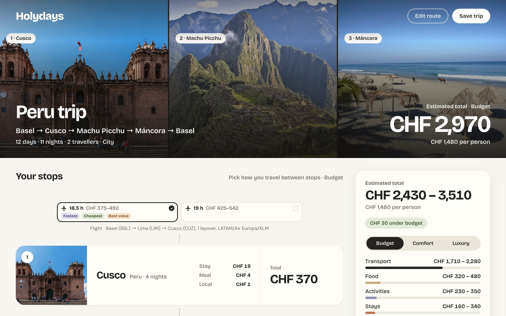
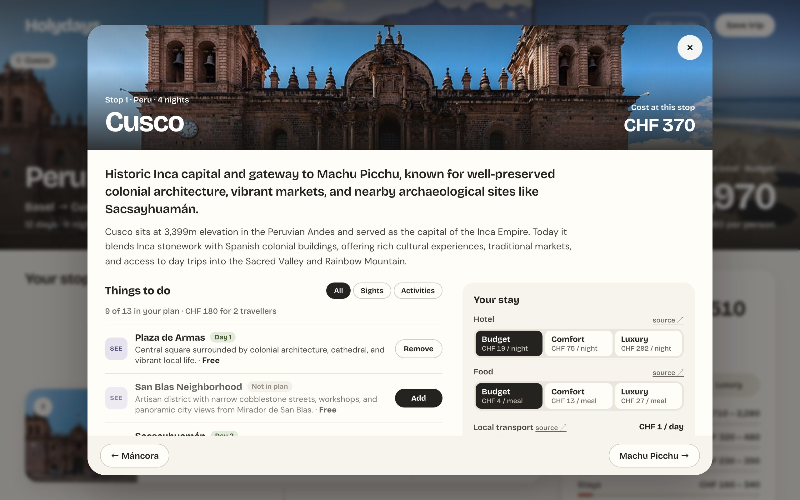
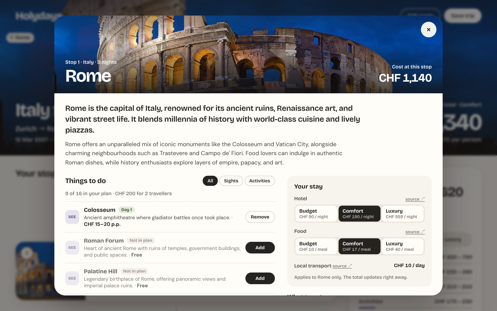
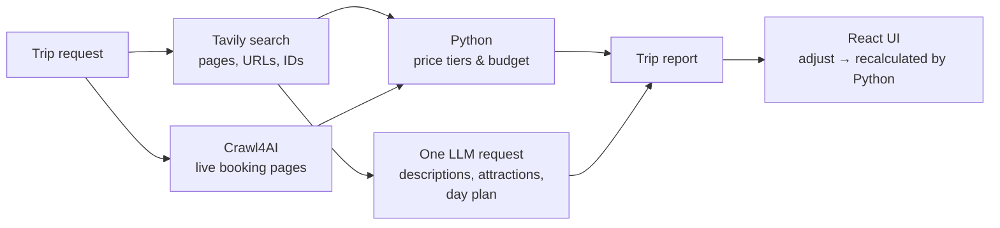

# Holydays

**An AI travel planner that builds a complete multi-stop trip (route, day plan and a cost estimate based on real prices) in under a minute, using only free LLMs.**

Pick places on a map, set your travellers and travel style, and Holydays researches the trip. It searches the web, reads live prices from booking sites in a local headless browser, computes the budget in Python and asks a free LLM to write the descriptions and the day-by-day plan. Each price links to the page it came from.



▶ [Full-quality video (1 min, MP4)](docs/demo.mp4)

---

## Screenshots

| Pick a destination | Build the route |
|---|---|
|  |  |
| **Plan stops and nights** | **The finished trip** |
|  |  |
| **Every stop in detail** | **Live prices with source links** |
|  |  |

## Features

- **Map-based trip builder**: choose a continent, country or city, add stops from destination cards, set the nights per stop and decide whether to return home.
- **Real prices, not guesses**: flights (Google Flights), buses (FlixBus), hotels (Trip.com, Airbnb, Hostelworld), rental cars and everyday costs (Numbeo) are read from the live pages for your dates and number of travellers. Train times come from Trainline.
- **Three budget tiers**: Budget, Comfort and Luxury, each with a price range per stop and category.
- **Interactive results**: switch the tier, pick a different transport option per leg, change the hotel or food level, add or skip attractions, or change the nights. The backend recalculates the total right away.
- **A source for every price**: each number links to the page it came from. Live prices link to the search page with your route and dates, and LLM estimates link to the search result they cite.
- **Day-by-day itinerary** with attractions, ticket prices and local dishes for each stop.
- **Live progress** while a trip is being researched, sent from the server as Server-Sent Events (SSE).

## How it works

Each part does only the work it is best at. The LLM writes the text, and Python computes every number.



| Part | Does | Does not |
|---|---|---|
| **Tavily** | Finds pages, URLs and site IDs. Results are cached per query and month. | Load live pages |
| **Crawl4AI** (local) | Loads booking pages for your place, dates and travellers, then reads the prices with CSS selectors and regexes, without an LLM | Bypass bot protection |
| **Python** | All numbers: price tiers, totals, per person/day, currency | Write text |
| **LLM** | One request per trip: place descriptions, attractions, dishes, day plan | Read prices or do math |

### Engineering highlights

- **About 40% faster per trip**: I measured the pipeline before optimizing it. Merging four LLM requests into one structured request and moving all calculations to Python cut a Rome trip from **73.9 s to about 45 s**.
- **Runs on free models only**: the primary model is a free NVIDIA model on OpenRouter, with a free backup model. Groq's free tier is the fallback when those are rate-limited. A token budget per minute keeps requests within Groq's limit, and requests that are too large are split automatically. A hard check in the code rejects any paid model.
- **Resilient**: if a model is down, rate-limited or returns an empty answer, the request moves to the next provider. Truncated JSON is retried, and invalid output gets a repair round. A missing live page doesn't stop the trip, which then falls back to search results.
- **Cached at every layer**: search results, live pages (1 day) and LLM answers are cached, so a repeated request costs nothing.
- **Tested**: 123 backend tests that need no network access, covering the price extraction schemas, LLM fallback and splitting, budget math and the adjust endpoint.

## Tech stack

| Layer | Tools |
|---|---|
| Backend | Python 3.13, FastAPI, Pydantic, SSE (sse-starlette), httpx |
| Scraping | Crawl4AI 0.9 + Playwright (headless Chromium), CSS extraction schemas |
| Search | Tavily API |
| LLM | OpenRouter (free NVIDIA Nemotron models), Groq (`gpt-oss-20b`, free tier) via the OpenAI SDK, JSON-schema structured output |
| Frontend | React 19, TypeScript, Vite, React Router, hand-drawn SVG world map |
| Data | GeoNames (offline city index), Wikipedia/Wikimedia (destination photos) |

## Project structure

```
backend/
  app/
    main.py            FastAPI app: trips, SSE progress, /adjust, title
    agent/synthesize.py  pipeline: collect data → one LLM request → finished trip
    search.py          Tavily search + cache
    live_prices.py     Crawl4AI: live booking pages
    live_extract.py    CSS schemas / regexes per site (no LLM)
    price_tiers.py     Budget / Comfort / Luxury from live rows
    budget.py          totals, per person / day, adjustments
    llm.py             providers, fallback, rate-limit budget, cache
  tests/               pytest, no network
frontend/src/
  pages/Builder.tsx    homepage + 3-step trip builder
  pages/TripPage.tsx   loading overlay with live progress
  pages/Result.tsx     results, stop details, adjustments
tools/                 CLI helpers: perf runs, trip comparison, live-price scraper
workflows/plan_trip.md the full planning procedure
```

## Running it locally

Requirements: Python 3.13, Node 20+, free API keys for [Tavily](https://app.tavily.com), [OpenRouter](https://openrouter.ai/keys) and optionally [Groq](https://console.groq.com/keys).

```bash
# 1. Keys
cp .env.example .env            # fill in the keys

# 2. Backend
cd backend
python3 -m venv .venv
.venv/bin/pip install -r requirements.txt
.venv/bin/playwright install chromium
cd ..
backend/.venv/bin/python tools/download_cities.py   # offline city index (GeoNames)

# 3. Frontend
cd frontend && npm install && cd ..

# 4. Start both (backend :8000, frontend :5173)
./dev.sh
```

Open http://localhost:5173. To try the UI without any API calls, run `backend/.venv/bin/python tools/seed_demo_trip.py` and open http://localhost:5173/trip/demo.

Tests: `cd backend && .venv/bin/python -m pytest -q`

## Notes and limitations

- This is a personal project, built to run locally. There is no hosted version.
- Live prices are read only from public search pages, at a low request rate (one page per site at a time, with a pause between requests). Sites that block headless browsers are skipped, not worked around.
- Prices are estimates for planning and are not bookable offers. Train prices and modes without a live source (car, ferry) are LLM estimates from search results and are marked as such.
- Currency is fixed to CHF for now.

## Credits

- City data: [GeoNames](https://www.geonames.org/) (CC BY 4.0)
- Destination photos: [Wikipedia / Wikimedia Commons](https://commons.wikimedia.org/)
- UI design created with Claude Design, implemented by hand in React
